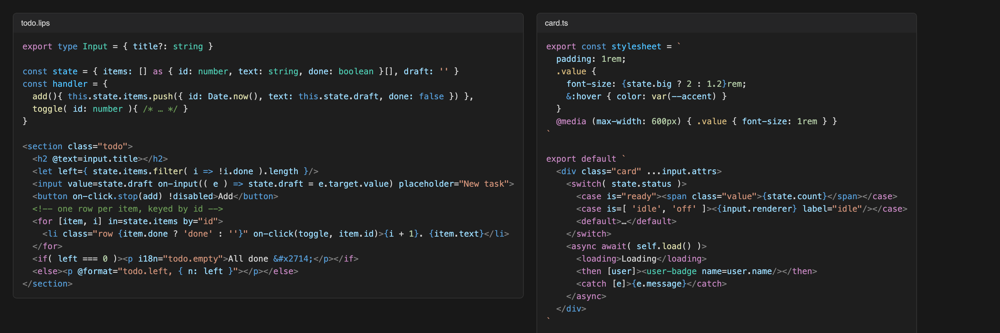

# Lips for VS Code

Highlighting for [Lips](https://github.com/fabrice8/lips) templates: `.lips`
files, and the templates and stylesheets of components written in TypeScript
or JavaScript.

- **`.lips` files**: the script is TypeScript; the template starts at the
  first line that opens with markup, as Lips's own parser splits it.
- **Templates**: HTML plus every construct Lips adds (`<if( … )>`, `<for [a, b] in=…>`,
  `<switch>`, `<async>`, `<let>`, `<macro>`, `<{expr}/>`, `on-click( … )`,
  `@text=`, `...spread`, …), with each expression coloured as TypeScript.
- **Stylesheets**: CSS with nesting and top-level declarations, and
  `{expr}` values coloured as TypeScript.
- **In `.ts` and `.js` files**, at the names Lips already reads, with no tag
  and no import: the `default`, `macros` and `stylesheet` fields of a
  component, `export default` / `export const macros` / `export const stylesheet`
  in a module, and `/* lips */` before any other template string.

Type checking, Lips's diagnostics and completion come in later versions
([RFC-009](https://github.com/lips-js/language-tools#readme)).
